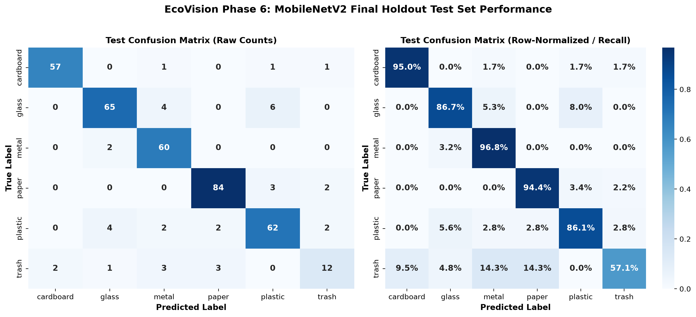

# EcoVision: Waste Image Classification with a Confidence Threshold

EcoVision is an end-to-end computer vision pipeline that classifies waste images into six categories (cardboard, glass, metal, paper, plastic, and trash). It uses a fine-tuned MobileNetV2 with a custom classification head, class weighting, and data augmentation. A confidence threshold of 0.80, chosen on the validation set, accepts a prediction only when the model is confident enough. Lower-confidence items are flagged as "uncertain" so they could be checked manually.

[](https://ecovision-evzcs2cqdcwsrhk3fvdbxu.streamlit.app)
[](https://github.com/kashifabrar24/EcoVision)

---

## Benchmark Results

All figures below come from saved evaluation reports (`reports/baseline_vs_transfer_val.csv`, `reports/augmentation_runs.csv`, `reports/test_comparison.csv`, and `reports/test_bootstrap_ci.json`). The test set was not used until the final evaluation (Phase 6) and was evaluated once.

| Model Pipeline | Val Accuracy | Val Macro-F1 | Test Accuracy (95% Bootstrap CI) | Test Macro-F1 (95% Bootstrap CI) |
| :--- | :---: | :---: | :---: | :---: |
| **Baseline CNN (Scratch)** | 69.13% | 0.6658 | 67.81% [63.05%, 72.30%] | 0.6477 [0.5953, 0.6959] |
| **MobileNetV2 Transfer (Phase 4)** | 90.50% | 0.8988 | *Not evaluated on test* | *Not evaluated on test* |
| **MobileNetV2 Final (Seed 44)** | **91.82%** | **0.9221** | **89.71% [86.54%, 92.61%]** | **0.8647 [0.8195, 0.9036]** |

### Per-Class Results (Test)

Per-class metrics for **MobileNetV2 Final** on the 379 holdout test images, extracted from `reports/test_metrics.json`:

| Class | Precision | Recall | F1-Score | Support |
| :--- | :---: | :---: | :---: | :---: |
| **Cardboard** | 0.9661 | 0.9500 | 0.9580 | 60 |
| **Glass** | 0.9028 | 0.8667 | 0.8844 | 75 |
| **Metal** | 0.8571 | 0.9677 | 0.9091 | 62 |
| **Paper** | 0.9438 | 0.9438 | 0.9438 | 89 |
| **Plastic** | 0.8611 | 0.8611 | 0.8611 | 72 |
| **Trash** | 0.7059 | 0.5714 | 0.6316 | 21 |
| **Macro Average** | **0.8728** | **0.8601** | **0.8647** | **379** |

---

## Dataset & Provenance

- **Primary Source:** Gary Thung and Mindy Yang, *TrashNet* ([github.com/garythung/trashnet](https://github.com/garythung/trashnet), commit `6fa2b87`).
- **Hugging Face Mirror:** The mirror (`garythung/trashnet`) contains 5,054 rows. These are the original archive (2,527 photos) plus the resized archive (512×384) of the same 2,527 photos, so every photo appears twice (2,527 × 2 = 5,054). Only one copy of each photo was used.
- **Label Conflict Removal:** An MD5 and perceptual-hash audit found 3 duplicate image pairs with contradictory class labels (`glass115.jpg` vs `metal91.jpg`, `glass176.jpg` vs `plastic152.jpg`, and `glass389.jpg` vs `plastic332.jpg`). All 6 ambiguous images were removed, leaving 2,521 clean images.
- **Class Distribution & Imbalance:** The imbalance ratio is **4.34:1**, between paper (594 images, 23.51%) and trash (137 images, 5.42%):
  - `paper`: 594 images (train: 416, val: 89, test: 89)
  - `glass`: 498 images (train: 348, val: 75, test: 75)
  - `plastic`: 480 images (train: 336, val: 72, test: 72)
  - `metal`: 409 images (train: 285, val: 62, test: 62)
  - `cardboard`: 403 images (train: 283, val: 60, test: 60)
  - `trash`: 137 images (train: 95, val: 21, test: 21)
  - **Total:** 2,521 images, split 70% train (1,763), 15% validation (379), 15% test (379), with a fixed seed (42).
- **Near-Duplicate Grouping:** Perceptual hashing (pHash) with connected components at Hamming distance <= 4 grouped near-identical photos into shared groups, and each group was kept inside a single split. This reduces leakage between train, validation and test, but cannot guarantee that no near-duplicates remain (see limitations).

---

## System Architecture


*Pipeline: dataset audit and de-duplication, stratified group split, 224x224 cache, baseline CNN and two-stage MobileNetV2, validation-based selection and threshold, final test evaluation, and inference/demo.*

---

## Methodology

1. **Baseline CNN:** Built from scratch with 4 convolutional blocks (Conv2d -> BatchNorm2d -> ReLU -> MaxPool2d), Global Average Pooling, Dropout (0.3), and a linear head (390,438 parameters). Trained with Adam (`lr=1e-3`), inverse-frequency class weights computed from the training split only, and early stopping on validation macro-F1 (patience 7).
2. **Two-Stage MobileNetV2 Fine-Tuning:**
   - *Stage 1 (feature extraction):* ImageNet-pretrained backbone frozen, training only the head (`Dropout(0.3) -> Linear(1280, 6)`) with Adam (`lr=1e-3`, max 10 epochs, patience 3).
   - *Stage 2 (fine-tuning):* The last 3 inverted residual blocks (`features[-3:]`) were unfrozen, with BatchNorm layers kept in `eval()` mode and different learning rates (`1e-4` backbone, `1e-3` head, max 20 epochs, patience 5).
3. **Data Augmentation Experiment (3 seeds):** Seeds 42, 43 and 44 compared training without augmentation against RandomHorizontalFlip, RandomRotation (±15°), ColorJitter and RandomResizedCrop (0.7–1.0). Augmentation gave a consistent **+0.0179 macro-F1** improvement on validation across the 3 seeds (0.9179 ± 0.0037 vs 0.9001 ± 0.0064) and reduced the train/val loss gap from 0.2769 to 0.1918. Three seeds is a small sample, so this is evidence, not proof. The seed 44 checkpoint had the highest validation macro-F1 (0.9221) and was saved as `models/mobilenetv2_final.pt`.

---

## Confidence Threshold (Selective Classification)

A prediction is accepted only if its confidence is at least the threshold; otherwise it is marked "uncertain".

The threshold was chosen **using validation predictions only** (`reports/threshold_sweep.csv`) with a rule fixed in advance: *highest coverage such that validation accuracy on answered images is >= 95%*. This selected **0.80**.

| Evaluation Split | Threshold | Coverage | Answered | Rejected | Accuracy on Answered | Macro-F1 on Answered |
| :--- | :---: | :---: | :---: | :---: | :---: | :---: |
| **Validation** | 0.80 | 92.88% | 352 / 379 | 27 (7.12%) | 95.17% | 0.9531 |
| **Test** | 0.80 | 86.81% | 329 / 379 | 50 (13.19%) | 95.14% | 0.9231 |

**Key finding:** The test set rejected more images than validation (50 / 13.19% vs 27 / 7.12%). A likely reason is that the checkpoint and the threshold were both chosen on validation, so validation is slightly optimistic (a hypothesis, not tested). On the answered test images, accuracy was 95.14%. The threshold removed 23 of the 39 test errors, but it also rejected 27 images that were classified correctly. This is the trade-off between coverage and accuracy. The threshold was not re-tuned on the test set.

---

## Error Analysis & Failure Cases




Out of 379 test images, 39 were misclassified (89.71% overall accuracy); all errors are listed in `reports/test_errors.csv`. Analysis of the test predictions reveals the top true $\rightarrow$ predicted confusion pairs observed:

1. **Glass $\rightarrow$ Plastic (6 misclassifications):** Clear glass bottles and jars predicted as plastic. *Untested hypothesis:* Transparent plastics and clear soda-lime glass share similar silhouettes and specular highlights against white backgrounds.
2. **Glass $\rightarrow$ Metal (4 misclassifications):** Glass items predicted as metal. *Untested hypothesis:* Dark tinted glass and jars with metallic lids produce strong specular glints or dark textures resembling metal cans.
3. **Plastic $\rightarrow$ Glass (4 misclassifications):** Clear plastic containers predicted as glass. *Untested hypothesis:* Rigid transparent PET containers exhibit visual reflections similar to glass bottles under studio lighting.
4. **Paper $\rightarrow$ Plastic (3 misclassifications):** Paper items predicted as plastic. *Untested hypothesis:* Coated, glossy magazines or laminated paper food packaging have reflective sheens resembling smooth plastic wrap.
5. **Trash $\rightarrow$ Metal (3 misclassifications):** Miscellaneous trash items predicted as metal. *Untested hypothesis:* Trash items containing metallic foil elements, batteries, or crumpled snack wrappers trigger metal texture features.
6. **Trash $\rightarrow$ Paper (3 misclassifications):** Miscellaneous trash items predicted as paper. *Untested hypothesis:* Composite waste containing discarded paper napkins, receipts, or cardboard fragments trigger paper patterns.

*(Note: Additional confusions observed at lower frequencies include metal $\rightarrow$ glass [2], paper $\rightarrow$ trash [2], plastic $\rightarrow$ paper [2], plastic $\rightarrow$ metal [2], and plastic $\rightarrow$ trash [2]. Trash had 9 false negatives in total out of 21 test samples, leading to its lower F1 of 0.6316.)*

---

## Latency Benchmarks

Measured with `src/measure_latency.py` (10 warm-up runs, 100 timed runs, `torch.cuda.synchronize()` on GPU).

- **Model parameters:** 2,231,558
- **Checkpoint size:** 8.75 MB (`models/mobilenetv2_final.pt`)

| Hardware | Device | Model only (Median / p95) | End-to-end (Median / p95) |
| :--- | :--- | :---: | :---: |
| **GPU** | NVIDIA GeForce RTX 3050 6GB Laptop GPU | 9.22 ms / 12.38 ms | 11.94 ms / 13.88 ms |
| **CPU** | AMD64 Family 25 Model 68 Stepping 1 | 22.95 ms / 31.95 ms | 24.38 ms / 29.38 ms |

End-to-end means image loading, preprocessing and the model. Both are fast enough for interactive use on a laptop.

---

## Reproduce from Scratch

### 1. Environment Setup
```bash
python -m venv venv
# Windows:
.\venv\Scripts\activate
# Linux/macOS:
source venv/bin/activate

# Install CUDA-enabled PyTorch:
pip install torch==2.6.0 torchvision==0.21.0 --index-url https://download.pytorch.org/whl/cu124
pip install -r requirements.txt
pip check
```

### 2. Pipeline Execution Order
```bash
# 1. Hardware verification
python src/check_gpu.py
python src/test_env.py

# 2. Dataset acquisition & audit
python src/download_dataset.py
python src/data_audit.py

# 3. Deduplication & stratified group split (caches 224x224 images to data/processed/)
python src/dedupe_split.py
python src/inspect_pairs.py

# 4. Models
python src/train_baseline.py
python src/train_transfer.py
python src/train_augmentation.py

# 5. Final test evaluation & threshold tuning
python src/evaluate_test.py
python src/tune_threshold.py

# 6. Latency benchmark
python src/measure_latency.py
```

---

## Inference Usage

### Command Line
```bash
python src/predict.py demo_examples/cardboard101.jpg
```
Example output (shortened):
```text
Image     : cardboard101.jpg
Predicted : cardboard
Confidence: 100.00%
Status    : ACCEPTED (confidence >= 80.0%)
```
The script also prints the top-3 classes. Images below the threshold are reported as UNCERTAIN.

### Python
```python
from PIL import Image
from src.predict import predict_image

img = Image.open("demo_examples/glass113.jpg")
result = predict_image(img)

print("Predicted Class :", result["predicted_class"])
print("Confidence      :", result["confidence"])
print("Uncertain Flag  :", result["uncertain"])
print("Probabilities   :", result["probabilities"])
```

### Web App
```bash
# Local Gradio interface (http://127.0.0.1:7860)
python app.py

# Local Streamlit interface
streamlit run space/streamlit_app.py
```
- **Live Cloud Demo:** [https://ecovision-evzcs2cqdcwsrhk3fvdbxu.streamlit.app](https://ecovision-evzcs2cqdcwsrhk3fvdbxu.streamlit.app)  
  *(Note: The live demo is hosted on Streamlit Community Cloud. A Hugging Face Space was not used because persistent Gradio Spaces require a paid plan, whereas Streamlit Community Cloud provides free public hosting for the standalone app).*


---

## Technical Notes & Limitations

- **Original image vs. cached 224 JPEG:** Predictions on the original 512×384 image can differ slightly from predictions on the cached 224×224 JPEG. The largest difference observed was 0.065 in confidence on one `trash` image, and the predicted class never changed. The reason is an **untested hypothesis**: the cache was saved as JPEG (`quality=95`), and that lossy re-encoding may change pixel values slightly.
- **Limitations for real campus waste:**
  1. *Clean backgrounds:* TrashNet photos are single items on a plain white background. Real campus waste is dirty, crushed, overlapping, and photographed under varied lighting and phone cameras.
  2. *Small dataset:* About 2.5k images across 6 classes.
  3. *Small trash class:* Only 137 trash images (about 21 in the test set), so trash metrics are unstable.
  4. *Missing categories:* No food-soiled items, multi-material items (e.g. coffee cups), food waste or e-waste, and only 6 classes in total.
  5. *Over-confident softmax:* Softmax confidence can be high even on unfamiliar items, so the threshold is not a guarantee.
  6. *Near-duplicate leakage:* Grouping by perceptual hash reduces but does not fully exclude near-duplicates across splits.
  7. *Validation selection effect:* Test macro-F1 (0.8647) is lower than validation macro-F1 (0.9221) because the checkpoint was selected on validation. The test numbers are the honest estimate.

---

## Credits & License

- **Dataset:** Gary Thung and Mindy Yang, *TrashNet* ([github.com/garythung/trashnet](https://github.com/garythung/trashnet)), MIT License.
- **How this was built:** AI coding assistants were used to write, document and test the code. Every reported number was generated by the scripts in this repository into `reports/` and `models/`.