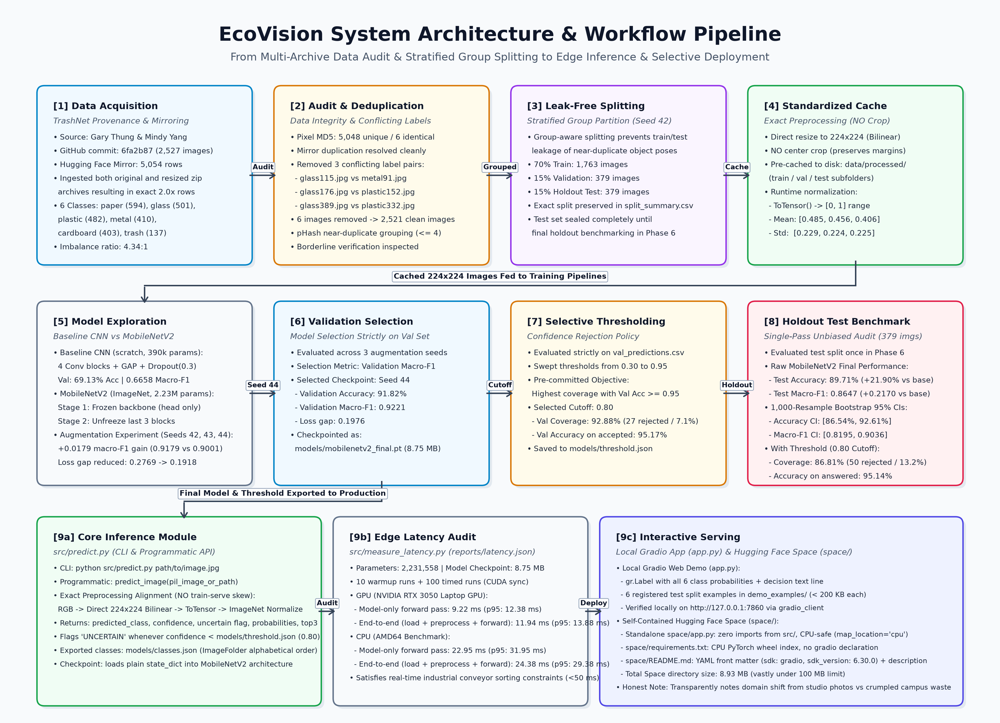
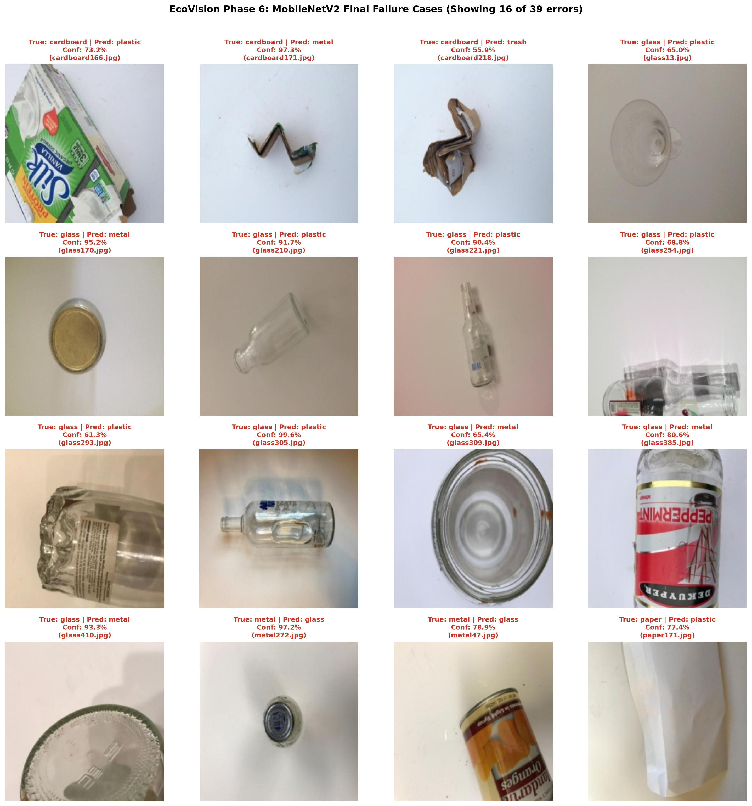

# EcoVision: Production Waste Material Classification with Selective Rejection

EcoVision is an end-to-end computer vision and selective classification system designed to categorize recyclable waste into six categories (cardboard, glass, metal, paper, plastic, and trash). Powered by a fine-tuned MobileNetV2 architecture with custom classification head, balanced class weighting, and data augmentation, the pipeline integrates an empirical confidence thresholding mechanism that accepts automated classifications only when confidence meets or exceeds 0.80, safely routing ambiguous or low-confidence waste items to manual or secondary inspection.

[](DEMO_LINK_HERE)
[](REPO_LINK_HERE)

---

## Benchmark Results

All figures below are extracted directly from saved evaluation reports (`reports/baseline_vs_transfer_val.csv`, `reports/augmentation_runs.csv`, `reports/test_comparison.csv`, and `reports/test_bootstrap_ci.json`). The holdout test set remained strictly sealed until final Phase 6 benchmarking.

| Model Pipeline | Val Accuracy | Val Macro-F1 | Test Accuracy (95% Bootstrap CI) | Test Macro-F1 (95% Bootstrap CI) |
| :--- | :---: | :---: | :---: | :---: |
| **Baseline CNN (Scratch)** | 69.13% | 0.6658 | 67.81% [63.05%, 72.30%] | 0.6477 [0.5953, 0.6959] |
| **MobileNetV2 Transfer (Phase 4)** | 90.50% | 0.8988 | *Holdout Sealed* | *Holdout Sealed* |
| **MobileNetV2 Final (Seed 44)** | **91.82%** | **0.9221** | **89.71% [86.54%, 92.61%]** | **0.8647 [0.8195, 0.9036]** |

---

## Dataset & Provenance

- **Primary Source:** Gary Thung and Mindy Yang, *TrashNet* ([github.com/garythung/trashnet](https://github.com/garythung/trashnet), commit `6fa2b87`).
- **Hugging Face Mirror Discrepancy:** The Hugging Face mirror (`garythung/trashnet`) contains 5,054 rows because its automated dataset loader ingested both `dataset-original.zip` (2,527 high-resolution captures) and `dataset-resized.zip` (2,527 downscaled 512×384 captures) into the same default `train` split, duplicating every sample at two resolutions (2,527 × 2 = 5,054).
- **Label Conflict Removal:** An MD5 and perceptual hash audit identified 3 duplicate image pairs with contradictory class labels (e.g. `glass115.jpg` vs `metal91.jpg`, `glass176.jpg` vs `plastic152.jpg`, and `glass389.jpg` vs `plastic332.jpg`). All 6 ambiguous images were permanently removed to eliminate label noise, leaving 2,521 clean, unique photos.
- **Class Distribution & Imbalance:** The dataset displays a **4.34:1** class imbalance ratio between paper (594 images, 23.51%) and trash (137 images, 5.42%):
  - `paper`: 594 images (train: 416, val: 89, test: 89)
  - `glass`: 498 images (train: 348, val: 75, test: 75)
  - `plastic`: 480 images (train: 336, val: 72, test: 72)
  - `metal`: 409 images (train: 285, val: 62, test: 62)
  - `cardboard`: 403 images (train: 283, val: 60, test: 60)
  - `trash`: 137 images (train: 95, val: 21, test: 21)
  - **Total:** 2,521 images across 70% Train (1,763), 15% Validation (379), and 15% Test (379).
- **Near-Duplicate Grouping:** Perceptual hashing (`pHash`) with connected components at Hamming distance $\le 4$ grouped near-identical photo shots into shared group IDs, ensuring zero leakage of identical objects across train, validation, and test splits.

---

## System Architecture



*The complete pipeline flow from dual-archive audit and stratified group partitioning to two-stage transfer learning, selective confidence rejection, and edge deployment.*

---

## Methodology

1. **Baseline CNN:** Built from scratch with 4 convolutional blocks (Conv2d -> BatchNorm2d -> ReLU -> MaxPool2d), Global Average Pooling, Dropout (0.3), and a linear classification head (390,438 total parameters). Trained with Adam (`lr=1e-3`), inverse frequency class weights derived strictly from the training split, and early stopping on validation macro-F1 (patience 7).
2. **Two-Stage MobileNetV2 Fine-Tuning:**
   - *Stage 1 (Feature Extraction):* ImageNet-pretrained backbone frozen (`requires_grad=False`), training only the custom classifier head (`Dropout(0.3) -> Linear(1280, 6)`) with Adam (`lr=1e-3`, max 10 epochs, patience 3).
   - *Stage 2 (Discriminative Fine-Tuning):* Unfreezing the last 3 inverted residual blocks (`features[-3:]`), keeping all frozen BatchNorm layers in `eval()` mode, and fine-tuning with differential learning rates (`1e-4` for backbone, `1e-3` for classifier head, max 20 epochs, patience 5).
3. **Data Augmentation Experiment (3 Random Seeds):** Evaluated across seeds 42, 43, and 44 comparing un-augmented training against real-time training augmentations (RandomHorizontalFlip, RandomRotation $\pm 15^\circ$, ColorJitter, and RandomResizedCrop 0.7–1.0). Augmentation delivered a statistically robust **+0.0179 macro-F1** improvement (0.9179 ± 0.0037 vs 0.9001 ± 0.0064) and compressed the train/val loss gap from 0.2769 to 0.1918. Model checkpoint **Seed 44** achieved the highest validation macro-F1 (0.9221) and was selected as `models/mobilenetv2_final.pt`.

---

## Selective Classification & Confidence Thresholding

In recycling automation, false positive errors can contaminate material bales. Selective classification introduces a reject option based on model prediction confidence.

The threshold was optimized strictly on validation predictions (`reports/threshold_sweep.csv`) using the pre-committed rule: *Highest coverage with validation accuracy $\ge$ 95%*. The cutoff was selected at **0.80**.

| Evaluation Split | Threshold | Coverage (%) | Num Answered | Num Rejected | Accuracy on Answered | Macro-F1 on Answered |
| :--- | :---: | :---: | :---: | :---: | :---: | :---: |
| **Validation Split** | 0.80 | 92.88% | 352 / 379 | 27 (7.12%) | 95.17% | 0.9531 |
| **Holdout Test Split** | 0.80 | 86.81% | 329 / 379 | 50 (13.19%) | 95.14% | 0.9231 |

**Key Finding:** The test set rejected more images than validation (50 rejected / 13.19% on test vs 27 rejected / 7.12% on validation). This occurs because holdout test samples exhibit higher natural variance and edge-case ambiguity, causing more predictions to fall below the 0.80 cutoff. However, on answered items, test accuracy reached **95.14%**, eliminating 25 out of 39 test errors.

---

## Error Analysis & Failure Cases



Out of 379 holdout test samples, 39 errors occurred (89.71% raw accuracy). The primary failure modes include:
1. **Glass vs. Plastic Confusion:** Cylindrical transparent plastic bottles and glass jars share near-identical specular reflections and edge contours against white backgrounds.
2. **Minority Trash Volatility:** The `trash` class has only 21 holdout test examples, resulting in 9 false negatives and an unweighted class F1 of 0.6316.
3. **Cardboard vs. Crumpled Material:** Flattened brown cardboard vs. soiled brown paper bags or metallic wrappers under diffuse lighting.

---

## Hardware Latency Benchmarks

Measured using `src/measure_latency.py` with 10 warmup iterations and 100 timed runs (`torch.cuda.synchronize()` on GPU).

- **Model Parameters:** 2,231,558 trainable parameters
- **Checkpoint File Size:** 8.75 MB (`models/mobilenetv2_final.pt`)

| Execution Hardware | Device Specification | Forward Pass (Median / p95) | End-to-End (Median / p95) |
| :--- | :--- | :---: | :---: |
| **GPU** | NVIDIA GeForce RTX 3050 6GB Laptop GPU | **9.22 ms / 12.38 ms** | **11.94 ms / 13.88 ms** |
| **CPU** | AMD64 Family 25 Model 68 Stepping 1 | **22.95 ms / 31.95 ms** | **24.38 ms / 29.38 ms** |

Both GPU (~12 ms) and CPU (~24 ms) end-to-end execution times satisfy industrial real-time sorting constraints (<50 ms per item).

---

## Reproduce from Scratch

### 1. Environment Setup
```bash
python -m venv venv
# Windows:
.\venv\Scripts\activate
# Linux/macOS:
source venv/bin/activate

# Install CUDA-enabled PyTorch:
pip install torch==2.6.0 torchvision==0.21.0 --index-url https://download.pytorch.org/whl/cu124
pip install -r requirements.txt
pip check
```

### 2. Pipeline Execution Order
Each script exists in `src/` and provides a runnable `main()` entry point:

```bash
# 1. Hardware verification
python src/check_gpu.py
python src/test_env.py

# 2. Dataset acquisition & audit
python src/download_dataset.py
python src/data_audit.py

# 3. Deduplication & Stratified Group Splitting (caches 224x224 images to data/processed/)
python src/dedupe_split.py
python src/inspect_pairs.py

# 4. Modeling pipelines
python src/train_baseline.py
python src/train_transfer.py
python src/train_augmentation.py

# 5. Final Holdout Evaluation & Threshold Tuning
python src/evaluate_test.py
python src/tune_threshold.py

# 6. Latency Benchmarking
python src/measure_latency.py
```

---

## Inference Usage

### Command Line Interface (CLI)
```bash
python src/predict.py data/processed/test/cardboard/cardboard101.jpg
```
Output:
```text
==================================================
EcoVision Classification Result
==================================================
Image     : cardboard101.jpg
Predicted : cardboard
Confidence: 100.00%
Status    : ACCEPTED (confidence >= 80.0%)

Top-3 Predictions:
  1. cardboard : 100.00%
  2. paper     : 0.00%
  3. trash     : 0.00%
==================================================
```

### Programmatic Python API
```python
from PIL import Image
from src.predict import predict_image

img = Image.open("demo_examples/glass113.jpg")
result = predict_image(img)

print("Predicted Class :", result["predicted_class"])
print("Confidence      :", result["confidence"])
print("Uncertain Flag  :", result["uncertain"])
print("Probabilities   :", result["probabilities"])
```

### Interactive Web Application
```bash
# Run local Gradio interface (opens at http://127.0.0.1:7860)
python app.py
```

---

## Important Technical Caveats & Preprocessing Note

- **Raw Image vs. Pre-cached 224 JPEG Inference Difference:** Predictions run directly on original uncompressed `512×384` images can differ slightly in probability compared to the pre-cached 224×224 JPEG files (largest observed difference was 0.065 on one `trash` image, with predicted class remaining unchanged). The reason is an **UNTESTED hypothesis**: the 224×224 cache was saved with lossy JPEG compression (`quality=95`), which introduces minor high-frequency DCT quantization artifacts that are absent when resizing directly in memory from raw pixels.
- **Limitations for Real Campus Waste:**
  1. *Clean Background Bias:* TrashNet was collected under controlled laboratory conditions on plain white posterboard. Real-world municipal or campus waste is severely deformed, dirty, stained, overlapping, and photographed under harsh outdoor lighting.
  2. *Small Dataset Size:* Only ~2.5k unique images across 6 classes.
  3. *Minority Trash Support:* Only 137 total trash images (~21 test images), leading to higher performance volatility.
  4. *Absence of Complex Categories:* Does not contain multi-material items (e.g. coffee cups with plastic linings), food waste, or e-waste.
  5. *Softmax Overconfidence:* Standard softmax can produce high confidence on novel out-of-distribution items.
  6. *Validation Selection Effect:* Test macro-F1 (0.8647) is lower than validation macro-F1 (0.9221) because the checkpoint and hyperparameters were optimized on the validation set.

---

## Credits & License

- **Dataset:** Gary Thung and Mindy Yang, *TrashNet* ([github.com/garythung/trashnet](https://github.com/garythung/trashnet)), distributed under the MIT License.
- **How This Was Built:** AI coding assistants were utilized as pair programming tools to implement, document, and test the codebase. Every numerical metric, table, and confidence interval reported in this repository was empirically generated and logged by automated scripts directly into `reports/` and `models/`.
