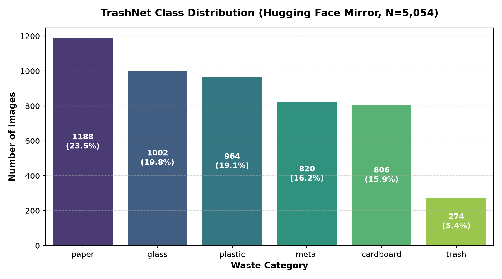
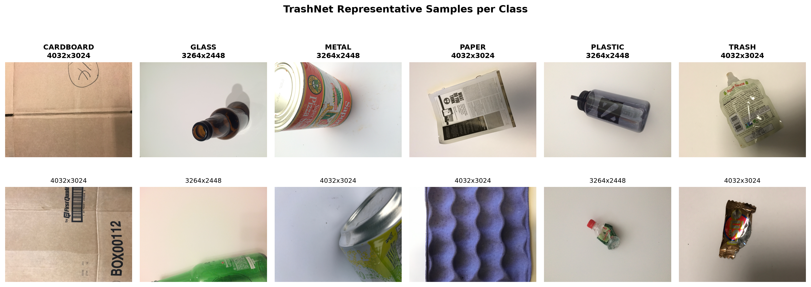

# TrashNet Dataset Audit & Specification (DATASET.md)

## 1. Overview & Provenance

The dataset used in EcoVision is **TrashNet**, originally compiled by Gary Thung and Mindy Yang (Stanford University, CS229 Computer Vision & Machine Learning project).

- **Primary Source (GitHub):** [garythung/trashnet](https://github.com/garythung/trashnet) at commit `6fa2b87`
- **Hugging Face Mirror:** [garythung/trashnet](https://huggingface.co/datasets/garythung/trashnet)
- **Problem Formulation:** Single-label multi-class image classification across 6 waste categories: `cardboard`, `glass`, `metal`, `paper`, `plastic`, and `trash`.
- **Unique vs. Mirror Size:** The **true unique benchmark size is 2,527 images**. The **5,054 figure is the Hugging Face mirror's doubled count**, caused by automatic ingestion of both original and resized archives.

---

## 2. Class Distribution & Imbalance Analysis

Official GitHub count states **2,527** unique images. The Hugging Face mirror reports **5,054** rows (an exact 2.0x factor).

The table below presents the verified counts per class extracted directly by `src/data_audit.py` and saved to `reports/class_counts_comparison.csv`:

| Class | GitHub Unique Count (`6fa2b87`) | Hugging Face Mirror Rows (Doubled) | Ratio (HF / GitHub) | Share of Dataset (%) |
| :--- | :---: | :---: | :---: | :---: |
| **paper** | 594 | 1,188 | 2.0000 | 23.51% |
| **glass** | 501 | 1,002 | 2.0000 | 19.83% |
| **plastic** | 482 | 964 | 2.0000 | 19.07% |
| **metal** | 410 | 820 | 2.0000 | 16.22% |
| **cardboard** | 403 | 806 | 2.0000 | 15.95% |
| **trash** | 137 | 274 | 2.0000 | 5.42% |
| **TOTAL** | **2,527** | **5,054** | **2.0000** | **100.00%** |

### Severe Imbalance: The "Trash" Minority Class
- The **`trash`** category is the extreme minority, comprising only **137 unique images (5.42%)**, whereas `paper` accounts for **594 images (23.51%)** — an imbalance ratio of **4.34 : 1**.
- **Implication for Modeling:** A naive classifier predicting solely the majority classes can achieve high overall accuracy while completely failing on actual miscellaneous waste. Therefore, training must incorporate **class-weighted cross-entropy loss** and model selection must prioritize **macro-averaged F1 score** over raw accuracy.

---

## 3. Investigation of the 5,054 vs. 2,527 Discrepancy

Rather than assuming duplicates, `src/data_audit.py` investigated the Hugging Face repository structure and raw bytecode empirically.

### Root Cause
1. **Repository Layout:** The Hugging Face repository root contains two zip archives:
   - `dataset-original.zip` (3.63 GB, contains 2,527 high-resolution photos ranging from 3264×2448 to 4032×3024 pixels).
   - `dataset-resized.zip` (42.8 MB, contains 2,527 downscaled photos at 512×384 pixels).
2. **Auto-Ingestion Mechanism:** When Hugging Face generates a dataset using the default `imagefolder` builder on an archive-based repository, it iterates over all archives located in the repo. Consequently, it concatenated all 2,527 original images and all 2,527 resized images into a single `train` split, producing exactly **2,527 + 2,527 = 5,054** rows.
3. **One-to-One Correspondence Proof:**
   - **Filename & Label Match:** Exactly 2,527 out of 2,527 pairs between the first half (`[0..2526]`) and second half (`[2527..5053]`) share identical original filenames and identical class labels (100% agreement).
   - **Perceptual Hash Distance:** 2,242 pairs (88.7%) have a perceptual hash (pHash) Hamming distance of **0**, and 100% have a distance **≤ 4** (mean Hamming distance: 0.2287).
   - **Resolution Contrast:** Samples 0..2526 are high-resolution (3264×2448 to 4032×3024); samples 2527..5053 are downscaled (512×384).

### Cross-Class Label Contamination & Removal Policy
Beyond the 2x resolution duplication, cryptographic MD5 hash analysis identified **3 pairs of exact duplicate images with conflicting labels** present in the benchmark:
1. `glass115.jpg` and `metal91.jpg` are byte-identical pixels (MD5: `319ffb5432...` at 4032×3024, `50035a9538...` at 512×384).
2. `glass176.jpg` and `plastic152.jpg` are byte-identical pixels (MD5: `31b82dd56c...` at 4032×3024, `03b62f7033...` at 512×384).
3. `glass389.jpg` and `plastic332.jpg` are byte-identical pixels (MD5: `92b8e0d530...` at 4032×3024, `814c3e8c70...` at 512×384).

**Phase 2 Removal Policy:**
Because the true ground-truth label for these images is ambiguous and unknowable without external verification, **BOTH images of each pair (6 images total)** are systematically removed from the modeling pipeline. They are logged in `reports/removed_images.csv` to ensure no contaminated labels corrupt training or artificially penalize validation/test evaluation.

---

## 4. Visualizations

### Class Imbalance Distribution (Unique Images, N=2,527)
The bar chart below illustrates the sample counts and relative percentages for all 6 categories across the unique 2,527 images:

*(Note: The mirrored 5,054-row chart is archived at `../reports/class_imbalance_hf_mirror_doubled.png` for reference).*

### Representative Samples
Below is a 2x6 sample grid showing representative waste objects from each of the 6 classes along with their resolutions:

---

## 5. Summary of Audit Artifacts

All figures and findings are verifiable from the code-generated artifacts stored in `reports/`:
- `reports/dataset_metadata.csv`: Full metadata index (dimensions, aspect ratio, MD5, pHash, dHash, aHash, local paths) for all 5,054 rows.
- `reports/class_counts_comparison.csv`: Exact GitHub vs. Hugging Face count and percentage breakdown.
- `reports/discrepancy_summary.json`: Mathematical and empirical verification of the 2x archive duplication and resolution ranges.
- `reports/class_imbalance.png`: High-resolution distribution chart of the unique 2,527 images.
- `reports/class_imbalance_hf_mirror_doubled.png`: Doubled mirror distribution chart archive.
- `reports/sample_grid.png`: High-resolution representative sample image grid.
- `reports/removed_images.csv`: Log of removed cross-class duplicate images with conflicting labels.
- `reports/cross_class_pairs.png`: Side-by-side comparison of cross-class pairs with pHash distance <= 4.
- `reports/near_duplicates_borderline.png`: Grid of borderline near-duplicate pairs at Hamming distances 3 and 4.
- `reports/near_duplicates_metrics.json`: Threshold evaluation across Hamming distances 0, 2, 4, and 6.

---

## 6. Near-Duplicate Analysis & Known Limitations

### Cross-Class Pair Inspection (Threshold <= 4)
At Hamming distance <= 4, exactly 2 cross-class pairs were identified:
1. `metal154.jpg` (metal) vs `plastic10.jpg` (plastic) — Hamming distance = 4
2. `metal159.jpg` (metal) vs `plastic11.jpg` (plastic) — Hamming distance = 2

Visual inspection (`reports/cross_class_pairs.png`) confirms that in both pairs, the items are clearly different physical objects (a metal soda can vs. a clear plastic water bottle) placed horizontally on the same white posterboard background. They are retained in the dataset because neither represents a labeling error or duplicate photograph; their pHash similarity arises from the dominance of the blank white background and roughly aligned silhouettes in low-frequency DCT space. By grouping them together, our Stratified Group Split guarantees both items in each pair remain in the same split, preventing any risk of leakage.

### Known Limitations
1. **Perceptual Hash Invariance Limits:** Perceptual hashing (pHash) cannot detect the same object photographed from significantly different camera angles, orientations, or under shifted lighting. Consequently, if the benchmark contains multi-angle shots of identical items that exceed distance 4, some cross-split leakage may remain, meaning validation/test accuracy could be slightly optimistic compared to real-world deployment on unseen objects.
2. **False Merges on Plain Backgrounds:** Because all TrashNet photos share identical white posterboard backgrounds, pHash can occasionally merge different small objects that share similar silhouettes (e.g. cans and bottles). While this is completely harmless for preventing data leakage (it merely forces both objects into the same split), it means some group clusters represent false merges rather than true duplicates.

